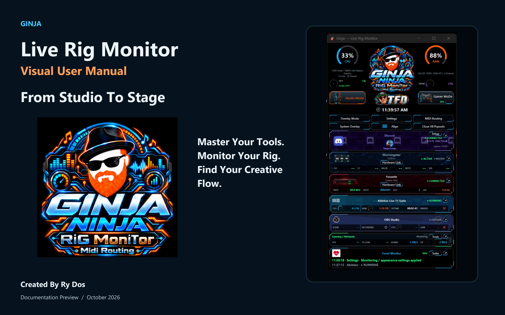
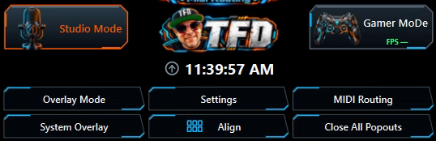
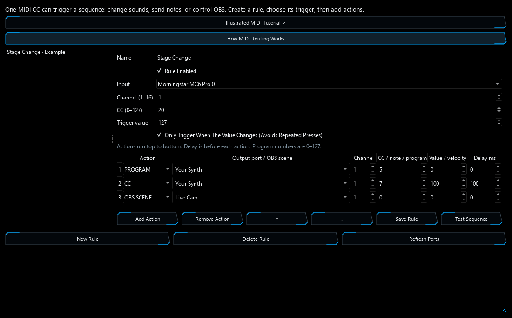

## Watch The Product Showcase

**[▶ Watch / Download — From Studio To Stage](https://github.com/rydos15/Ginja-Live-Rig-Monitor/releases/tag/showcase-v1)**

https://github.com/user-attachments/assets/5513752c-b422-45b7-8ff4-940820663562

See Ginja’s dashboard, popout monitors, and MIDI workflows in a real studio and live-performance setup.
# Ginja Live Rig Monitor

### Explore The Project

**[Start Here: Rig Integration And Software Rollout — PDF](https://github.com/rydos15/Ginja-Live-Rig-Monitor/releases/download/portfolio-docs-v1/Ginja_Rig_Integration_And_Software_Rollout.pdf)**  
The presentation companion to the video: the routing problem, integration decisions, coordinated workflows and software delivery approach.

**[Go Deeper: Code Anatomy — PDF](https://github.com/rydos15/Ginja-Live-Rig-Monitor/releases/download/portfolio-docs-v1/Ginja_Code_Anatomy.pdf)**  
The technical reference connecting application features to MIDI input, rule matching, execution, dashboard feedback and diagnostics.

Ginja is a working Windows application developed for my studio workflow. Application source and binaries remain private. A live demonstration is available on request.

**Monitor · Route · Integrate · Perform · Stream · Troubleshoot**

Created by **Ry Dos** · [Visual Manual](docs/USER-MANUAL.md) · [Designed PDF](docs/Ginja_Visual_User_Manual.pdf) · [Roadmap](ROADMAP.md) · [Feedback](SUPPORT.md)

## A Real Rig. A Working Suite.

Ginja brings system readings, MIDI activity, audio-device information and application state into one Windows workspace. Movable popouts put feedback beside the tool in use. A CC-triggered sequence editor sends ordered MIDI messages and supported OBS actions.

The project grew from the creator's studio and live-performance requirements, including a Morningstar MC6 Pro with two custom 3D-printed external controls using resistor ladders. The creator reports successful use in their own workflow. Broader compatibility remains a separate validation task.

**This is a portfolio showcase. Application source and executable downloads are not publicly available.**

## The Application In Focus

| Area | Current Implementation | Guide |
| :--- | :--- | :--- |
| Monitoring | CPU/RAM, available GPU/VRAM sensors, hardware and app cards | [Dashboard Tour](docs/USER-MANUAL.md#one-view-of-the-rig) |
| Workspace | Popouts, alignment, appearance controls and profiles | [Popout Tour](docs/USER-MANUAL.md#feedback-where-the-work-happens) |
| MIDI Routing | CC triggers, ordered MIDI messages, waits and supported OBS actions | [Illustrated Tutorial](docs/USER-MANUAL.md#01--observe-the-trigger) |
| Production And Streaming | Ableton process telemetry, audio-device information and OBS WebSocket state | [OBS Workflow](docs/USER-MANUAL.md#session-state-beside-the-live-stream) |
| Gaming And Network | Optional PresentMon displayed FPS, frame-time history, transfer rates and optional ping | [Gaming Tools](docs/USER-MANUAL.md#displayed-fps-and-frame-time-history) |
| Troubleshooting | Events, process metrics and local session reports | [Event Monitor](docs/USER-MANUAL.md#a-timeline-for-troubleshooting) |
| Discord | Desktop process monitoring and optional profile/Rich Presence connection | [Discord Setup](docs/USER-MANUAL.md#profile-connection-and-sharing-controls) |

## An Input Becomes A Sequence

An explicit device/channel/CC/value condition starts an ordered sequence. Supported outputs include CC, program change, note on/off, waits, OBS scene changes and start/stop recording. Test Sequence sends actual actions. Tutorial screenshots are read-only examples. The current engine does not claim arbitrary protocol routing or every planned integration.

## Product Documentation

- [46-Page Visual User Manual](docs/Ginja_Visual_User_Manual.pdf)
- [Practical Configuration Workflows](docs/USER-MANUAL.md#practical-workflows)
- [Product Release Handbook](docs/Ginja_Product_Release_Handbook.pdf)
- [Release Notes](docs/RELEASE-NOTES.md) · [Changelog](CHANGELOG.md) · [Support](SUPPORT.md)

## A Manual You Can Use

The visual field guide covers the same workflow as the showcase, with large interface captures and step-by-step instructions. It explains what a reading means, how to configure a feature and what to check when a result is unavailable.

- [Browse The Illustrated Manual](docs/USER-MANUAL.md)
- [Read The Designed PDF](docs/Ginja_Visual_User_Manual.pdf)
- [See Data Handling And Attribution](docs/Ginja_Portfolio_Usage_And_Attribution.pdf)

## The Engineering Story

Explore the [Case Study](docs/CASE-STUDY.md), [Architecture](docs/ARCHITECTURE.md), [Validation Plan And Known Limits](docs/VALIDATION.md) and [Product Release Checklist](docs/RELEASE-CHECKLIST.md). These explain the problem, design decisions, evidence and path to a distributable product.

## Current Work And Planned Work

Current monitoring and CC-triggered routing are documented separately from planned Push 3 extensions, deeper Ableton integration, Synesthesia visualization, Stream Deck and Xbox-controller workflows. [Read The Roadmap](ROADMAP.md).

## Feedback

Use the Issues tab for reproducible problems or workflow suggestions. Include the feature, exact steps, environment and redacted evidence. Find **Ginja / rydos15** on [GitHub](https://github.com/rydos15).

---

Independent project. No manufacturer affiliation, endorsement or certification is claimed. Captures show recorded/example values. Studio screen replacements and illustrative activity are identified in the manual. [Rights And Attribution](RIGHTS.md) · [Privacy](PRIVACY.md).
