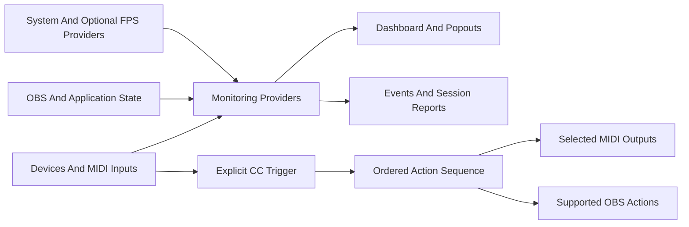

# How The Suite Fits Together

## Monitoring

Providers supply system readings, device information, application state and optional FPS/network observations. The dashboard and popouts present those observations. Availability depends on the connected hardware, installed drivers and configured providers.

## Control

The reviewed routing engine matches control-change messages. A rule identifies an input, channel, CC and trigger value or Any Value. Its actions execute in order, with supported delays. Outputs include MIDI CC, program change, note on/off, waits, OBS scene changes and start/stop recording. The current implementation is not a general-purpose arbitrary-protocol router.

## Evidence And Preferences

Preferences, rules, events and session reports are local in the reviewed implementation. Reports help reproduce a session; they can contain identifying device/app names, paths and errors. Discord profile connection and public Rich Presence sharing are separate choices. OBS uses its configured WebSocket endpoint.

## Extension Boundaries

Planned integrations require implementation and validation. A concept image or arrow does not establish a working adapter. Dependency licensing and packaged-runtime behavior must be reviewed before offering an executable to others.

[User Manual](USER-MANUAL.md) · [Privacy](../PRIVACY.md) · [Roadmap](../ROADMAP.md)
