# Ginja Visual User Manual

**From Studio To Stage** · Created by **Ry Dos**

[Read The Designed PDF](Ginja_Visual_User_Manual.pdf)

- [A Real Problem. A Working Suite.](#a-real-problem-a-working-suite)
- [First Launch And A Known-Good Baseline](#first-launch-and-a-known-good-baseline)
- [One View Of The Rig](#one-view-of-the-rig)
- [Modes, Buttons And Compact Cards](#modes-buttons-and-compact-cards)
- [CPU, RAM And Available GPU Telemetry](#cpu-ram-and-available-gpu-telemetry)
- [Feedback Where The Work Happens](#feedback-where-the-work-happens)
- [Session State Beside The Live Stream](#session-state-beside-the-live-stream)
- [MC6 Pro And 3D-Printed Foot Controls](#mc6-pro-and-3d-printed-foot-controls)
- [01 / Observe The Trigger](#01--observe-the-trigger)
- [02 / Define The Rule](#02--define-the-rule)
- [03 / Order The Actions](#03--order-the-actions)
- [04 / Save And Test Deliberately](#04--save-and-test-deliberately)
- [05 / Pair Notes And Handle Failures](#05--pair-notes-and-handle-failures)
- [An Expandable CC-Triggered Hub](#an-expandable-cc-triggered-hub)
- [The Session And Its Supporting Rig](#the-session-and-its-supporting-rig)
- [Device Information With Clear Limits](#device-information-with-clear-limits)
- [Profile Connection And Sharing Controls](#profile-connection-and-sharing-controls)
- [Displayed FPS And Frame-Time History](#displayed-fps-and-frame-time-history)
- [Throughput And Optional Latency](#throughput-and-optional-latency)
- [A Timeline For Troubleshooting](#a-timeline-for-troubleshooting)
- [Resource Use At The Application Level](#resource-use-at-the-application-level)
- [A Reproducible Test Record](#a-reproducible-test-record)
- [Saved Layouts For Different Workflows](#saved-layouts-for-different-workflows)
- [Readable Controls And Predictable Behavior](#readable-controls-and-predictable-behavior)
- [Choose The Metrics That Matter](#choose-the-metrics-that-matter)
- [From A Symptom To A Useful Report](#from-a-symptom-to-a-useful-report)
- [Push 3 And Deeper Ableton Workflows](#push-3-and-deeper-ableton-workflows)
- [Synesthesia, Stream Deck And Controllers](#synesthesia-stream-deck-and-controllers)

## A Real Problem. A Working Suite.

A studio rig spreads its status across devices, drivers, applications and performance controls. Ginja brings those observations into one workspace.

The creator reports using Ginja in their own studio and live-performance workflow. The suite combines visible feedback with a CC-triggered sequence router. That pattern can apply to other compatible MIDI systems without claiming every external application is already integrated.

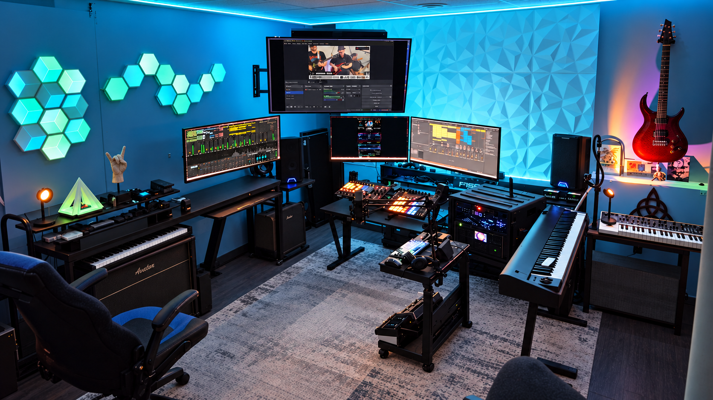

*Creator-Supplied Studio Photo With Cleanup And Screen Compositing. This Is An Illustrative Product Scene.*

1. **Observe:** Read the device and application state before acting.
2. **Coordinate:** Use explicit rules and known MIDI destinations.
3. **Review:** Use events and session reports to investigate issues.

**The Engineering Story:** Real requirements informed the interface, hardware workflows and expansion plan.

## First Launch And A Known-Good Baseline

Start with one device and one application. Confirm each layer before building a more complicated workflow.

For a private portable build, extract the complete ZIP and keep its bundled folders beside the EXE. Install device drivers separately. Ginja does not bundle Ableton, OBS, Discord or PresentMon. Public application downloads are not currently offered.

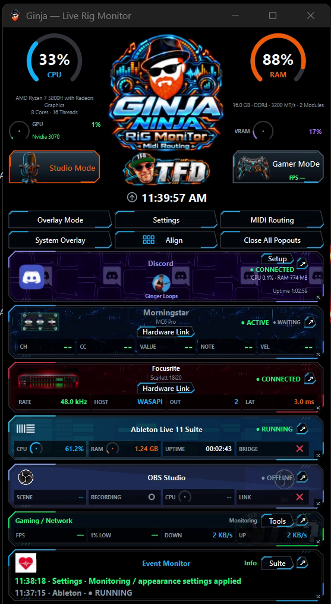

*Actual Interface Capture. Displayed Values Are A Recorded Snapshot Or Example.*

1. **Launch:** Confirm the dashboard and artwork load.
2. **Connect:** Plug in a device and check its detected state.
3. **Verify:** Open Event Monitor and inspect errors or reconnects.

**A Repeatable Starting Point:** Record the PC, drivers and application versions so later tests have a baseline.

## One View Of The Rig

The dashboard combines system telemetry, hardware cards and application state. Each reading has a specific source and meaning.

CPU/RAM and available GPU/VRAM readings sit above the controls. Discord, MIDI, audio, Ableton, OBS, Gaming / Network and Event Monitor provide focused cards. An unavailable field is not zero, and a running process is not proof that the entire workflow is healthy.

*Actual Interface Capture. Displayed Values Are A Recorded Snapshot Or Example.*

1. **System:** Resource readings and available hardware identity.
2. **Devices And Apps:** Connection and activity fields beside each tool.
3. **Events:** Recent observations and access to deeper tools.

**Understand The Evidence:** Read the card fields as observations, not certification that every cable or audio path is working.

## Modes, Buttons And Compact Cards

The main controls choose how information appears. They are separate from the routing engine.

Studio Mode favors music-production cards. Gamer Mode shows gaming, events and Discord. Overlay Mode opens available monitors. System Overlay opens the compact system view. Align arranges popouts. Close All Popouts collects detached views. A card X collapses its content and + restores it.

*Actual Interface Capture. Displayed Values Are A Recorded Snapshot Or Example.*

1. **Choose A Mode:** Use the workspace appropriate to the current task.
2. **Open A Popout:** Use the card control to detach its monitor.
3. **Adjust Visibility:** Settings > Dashboard hides cards completely.

**Visibility Does Not Stop Routing:** A hidden or collapsed card can still be monitored in the background.

## CPU, RAM And Available GPU Telemetry

The system overlay keeps the selected readings visible beside the active application.

Settings > System Overlay independently selects CPU, RAM, GPU, VRAM and FPS. Missing sensors remain unavailable. Reported RAM speed comes from Windows inventory rather than a live benchmark. Provider and hardware differences affect which GPU fields are available.

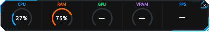

*Actual Interface Capture. Displayed Values Are A Recorded Snapshot Or Example.*

1. **Select Metrics:** Choose the fields relevant to your workload.
2. **Size The Overlay:** Adjust its size, text and opacity.
3. **Interpret Gaps:** Check providers before treating a dash as a fault.

**Readings With Context:** Use trends and events together. One percentage cannot identify the cause of every problem.

## Feedback Where The Work Happens

Independent popouts let you keep useful feedback beside Ableton, OBS or another active workspace.

Unlock positions in Settings > Appearance / overlays to move and resize. Set the popout size, background, opacity and text size. Align creates a predictable arrangement. Close or Escape returns a monitor. Save a custom workspace profile once the arrangement is useful.

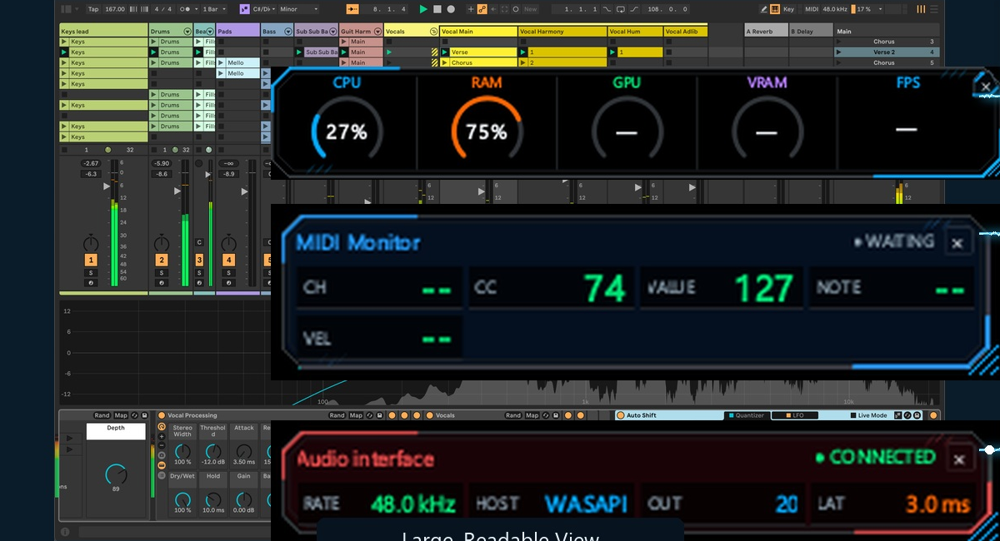

*Captured Popouts Arranged Over An Ableton Screenshot. Example Layout, Not New Live Telemetry.*

1. **Arrange:** Place monitors beside the application they support.
2. **Refine:** Use readable sizes and consistent spacing.
3. **Preserve:** Lock positions and save the current layout.

**A Workspace, Not A Fixed Layout:** The illustrated arrangement is one example. Popout selection depends on available monitors.

## Session State Beside The Live Stream

OBS creates the stream. Ginja provides a connected view of OBS state and supported control actions.

In OBS, enable Tools > WebSocket Server Settings. In Ginja, enter the matching host, port and password under Settings > OBS connection and apply. Defaults are localhost and 4455. The reviewed code saves host/port and holds the password only for the current run.

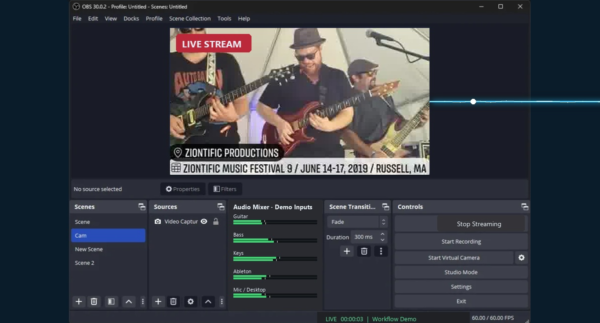

*Recorded Performance Inside An OBS Preview. Animated Mixer/Connection Elements Are Illustrative Workflow Composites.*

1. **Connect:** Match OBS server settings and re-enter the password after a restart.
2. **Observe:** Check scene and recording/streaming state.
3. **Control:** Use scene and start/stop-recording actions in a MIDI sequence.

**Current Action Boundary:** Start/stop streaming is not in the reviewed routing-action list.

## MC6 Pro And 3D-Printed Foot Controls

The creator extended a Morningstar MC6 Pro with two custom 3D-printed external foot controllers using resistor ladders.

The physical controllers and Morningstar programming produce MIDI messages. Ginja monitors those messages and uses matching CC inputs to trigger configured sequences. The resistor ladder is part of the hardware setup, not an electrical feature implemented by Ginja.

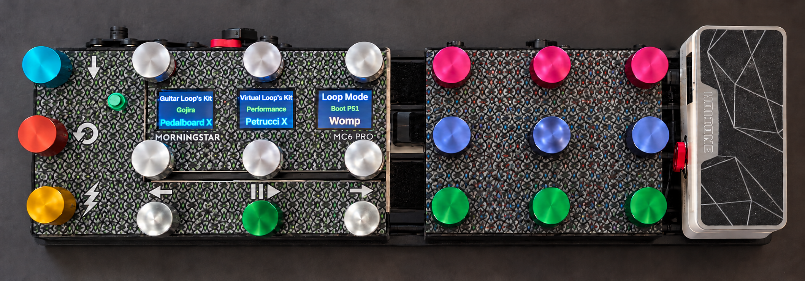

*Creator-Supplied MC6/Pedal Photo With Cable Cleanup And A Matching Switch-Cap Edit.*

1. **Configure Hardware:** Use the manufacturer guidance for the real controller.
2. **Observe MIDI:** Confirm the actual channel, CC and values.
3. **Map A Rule:** Match the observed message to a specific output sequence.

**Hardware Context:** This manual does not prescribe resistor values, wiring or manufacturer-approved expansion designs.

## 01 / Observe The Trigger

Begin with the message the controller actually sends. The illustrated trigger uses channel 1, CC 20 and value 127.

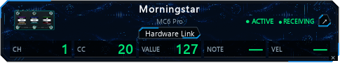

*Actual tutorial capture. Example values. Tutorial is read-only.*

1. **Press The Control:** Watch the MIDI monitor for the channel, CC and value.
2. **Check Release:** A release may send a different value. Observe both states.
3. **Record The Fields:** Use those observed values when creating the rule.

**Monitoring And Triggering Differ:** Notes and velocity appear in monitoring, but the reviewed rule engine triggers on MIDI control-change messages.

## 02 / Define The Rule

Create a named rule with an explicit input and trigger. Save it after reviewing the destination sequence.

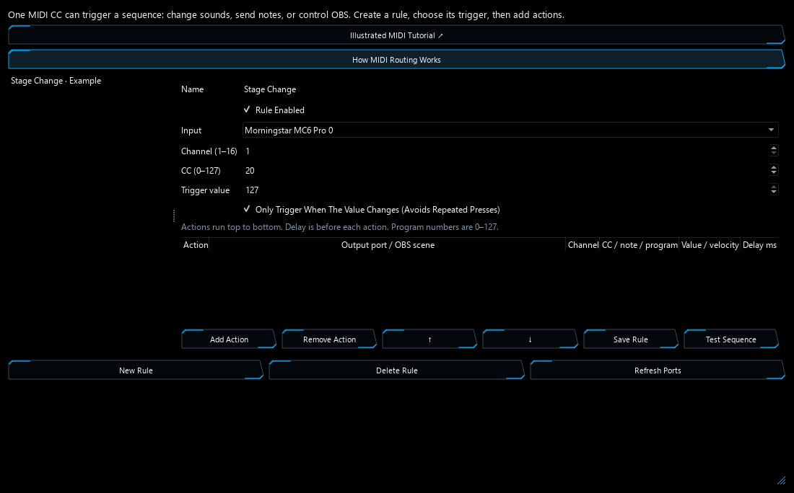

*Actual tutorial capture. Example values. Tutorial is read-only.*

1. **Choose Input:** Select the real controller or Any Connected Input.
2. **Match The Trigger:** Set channel 1-16, CC 0-127 and a value or Any Value.
3. **Control Repeats:** Value Changes suppresses identical repeated values. Enable and save.

**Any Value Can Run Often:** When a continuous controller sends many changes, Any Value can cause repeated sequences. Choose deliberately.

## 03 / Order The Actions

One matching CC can start an ordered sequence. Delay is applied before an action. WAIT adds a pause.

*Actual tutorial capture. Example values. Tutorial is read-only.*

1. **Choose The Type:** CC, PROGRAM, NOTE ON/OFF, WAIT or supported OBS action.
2. **Set The Destination:** Use the real MIDI output port or exact OBS scene name.
3. **Order And Delay:** Arrange actions top to bottom and set delays in milliseconds.

**Protocol Numbering:** Channels are 1-16 in the UI. MIDI numbers/values are 0-127. PROGRAM values can differ from displayed preset numbers.

## 04 / Save And Test Deliberately

The tutorial capture uses example destinations. Your real rule must use your own connected outputs.

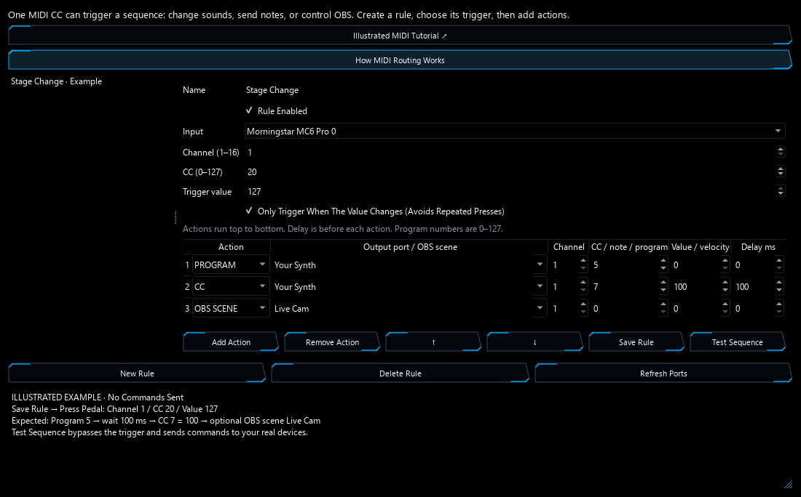

*Actual tutorial capture. Example values. Tutorial is read-only.*

1. **Save Rule:** Persist the intended fields and action list first.
2. **Test Sequence:** This sends actions immediately, without waiting for the trigger.
3. **Inspect Results:** Check the target device and sequence/event logs, then test the real control.

**Test Sequence Is Not A Dry Run:** Use a known, low-impact destination. Tutorial screenshots are read-only examples and send no commands.

## 05 / Pair Notes And Handle Failures

A NOTE ON needs a corresponding NOTE OFF when you intend the note to end.

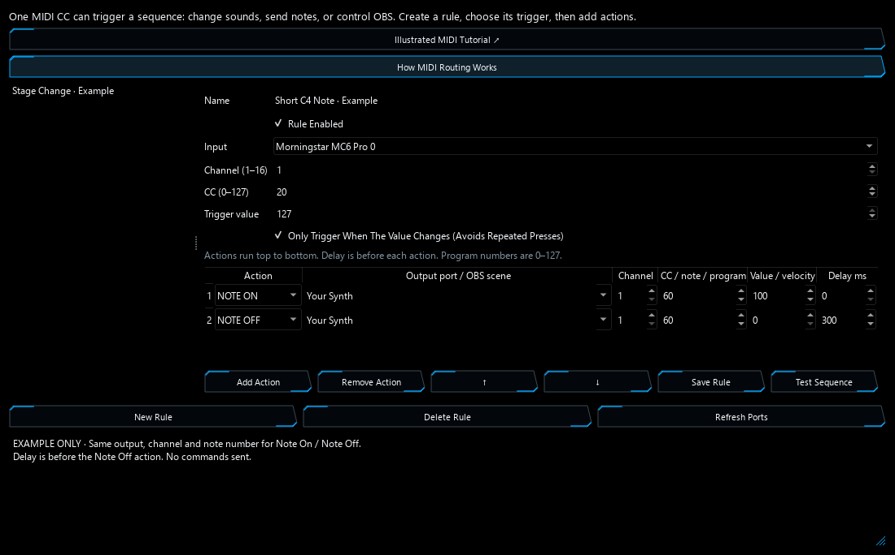

*Actual tutorial capture. Example values. Tutorial is read-only.*

1. **Pair The Messages:** Use matching pitch, channel and destination.
2. **Keep Timing Explicit:** Set a deliberate delay before the note-off action.
3. **Review The Failure:** Errors stop a sequence. Fix the cause before repeating it.

**Sequence Scheduling:** The executor runs actions in order. The same rule is not queued again while it is already queued/running.

## An Expandable CC-Triggered Hub

The routing pattern is reusable: an input condition starts an explicit sequence of supported actions.

A controller can send a program change, wait, send a CC and switch an OBS scene. Compatible MIDI equipment can use that same structure in other workflows. The current engine does not imply arbitrary protocol routing, a visual macro builder or unimplemented service integrations.

*Actual Interface Capture. Displayed Values Are A Recorded Snapshot Or Example.*

1. **Input Condition:** Device, channel, CC and value identify the trigger.
2. **Ordered Outputs:** Each action has a destination and parameters.
3. **Observed Outcome:** Logs show successful steps or where the sequence stopped.

**Example Sequence:** CC 20 / Ch 1 / Value 127: PROGRAM 5 to your synth, then CC 7 / Value 100 after 100 ms.

## The Session And Its Supporting Rig

Ginja monitors Ableton application/process telemetry beside hardware and MIDI activity.

A running process, CPU/RAM and uptime help you see the application context. Ableton mappings and the target device determine what routed MIDI does. Ginja does not currently claim complete track-state access, audio mixing or control of every Ableton function.

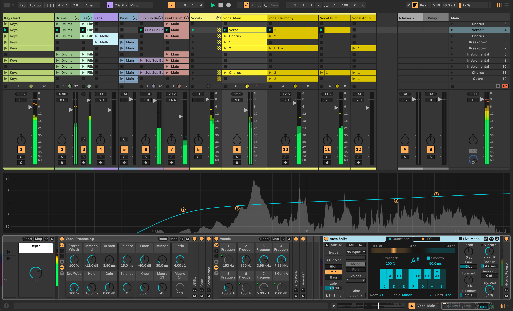

*Actual Interface Capture. Displayed Values Are A Recorded Snapshot Or Example.*

1. **Open The Session:** Confirm Ableton appears as running.
2. **Check The Rig:** Observe MIDI and audio information alongside it.
3. **Apply Mappings:** Verify your external MIDI mapping in the actual session.

**Upcoming:** Deeper Ableton integration and Push 3 expansions are development directions, not delivered capabilities.

## Device Information With Clear Limits

The audio monitor exposes available device/host information rather than acting as an audio mixer.

Device detection, sample-rate/channel fields and available latency information depend on the query and driver. Hardware Link opens the configured control application. A generic driver label may need a correct model label in Settings > Devices. These fields do not prove that sound is audible or every cable is healthy.

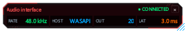

*Actual Interface Capture. Displayed Values Are A Recorded Snapshot Or Example.*

1. **Install The Driver:** Use the appropriate interface driver on each PC.
2. **Confirm Identity:** Check the real model and host information.
3. **Diagnose In Context:** Compare with the DAW/interface settings when sound fails.

**A Successful Query Is Not An Audio Test:** For portable builds, the audio-discovery helper must be included and work without installed Python.

## Profile Connection And Sharing Controls

Discord process detection and a profile connection mean different things. Public Rich Presence is a separate choice.

Open Setup or the Discord Presence tools. Enter your own Application ID, keep desktop Discord open, review the profile and sharing switches, and apply. Saved settings and migrations can restore choices. A running process is not proof of Online/Invisible status or voice connectivity.

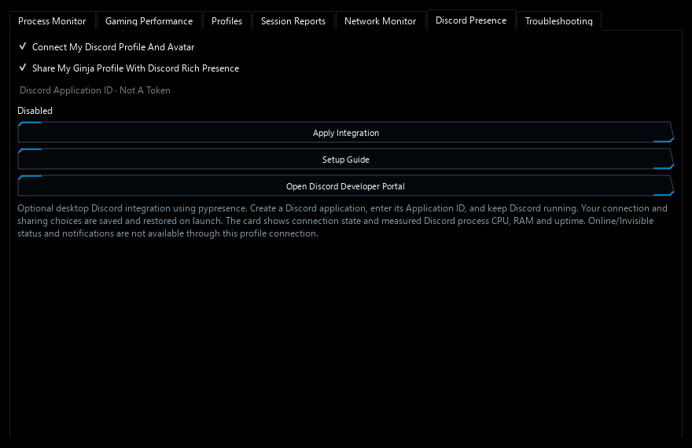

*Actual Interface Capture. Displayed Values Are A Recorded Snapshot Or Example.*

1. **Application ID:** Use an ID, never a user token or password.
2. **Profile Connection:** RPC can return the name and public avatar.
3. **Public Sharing:** Rich Presence publishes selected activity when enabled.

**Data Boundary:** Online/Invisible status and notification feeds are not available through this profile connection.

## Displayed FPS And Frame-Time History

The gaming tools help you inspect pacing and resource behavior while keeping the rest of the suite nearby.

Install the official PresentMon console executable separately. Browse to it, select a running game, and Start FPS Capture. The reviewed provider uses DisplayedTime and the busiest recent swap chain. FPS is averaged over five seconds. 1% low needs at least 100 valid frames, and readings expire after three seconds without frames.

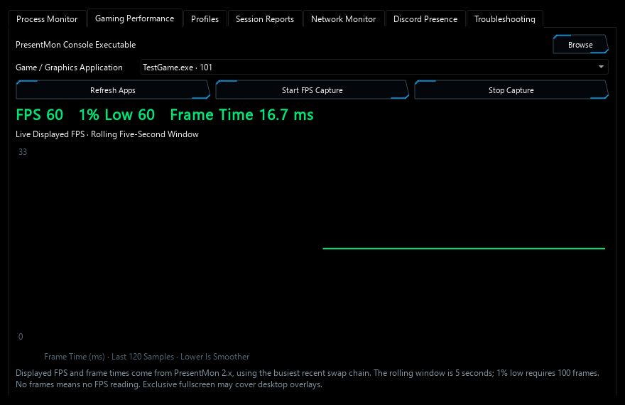

*Actual Interface Capture. Displayed Values Are A Recorded Snapshot Or Example.*

1. **Select The Provider:** Use the console executable, not a guessed FPS source.
2. **Choose The Process:** Select the game or use a process from Process Monitor.
3. **Inspect Pacing:** Read frame-time history and capture errors together.

**Provider Limits:** Displayed FPS may include generated frames. Game/driver/ETW behavior affects capture. Start in borderless windowed mode.

## Throughput And Optional Latency

Network tools provide system-wide download/upload rates and optional ICMP latency to a chosen host.

Throughput is an aggregate system measurement, not attribution to one game or application. Rates require a previous sample. A ping result describes the chosen target and can be blocked by the network. It is not proof that a streaming service or game server is healthy.

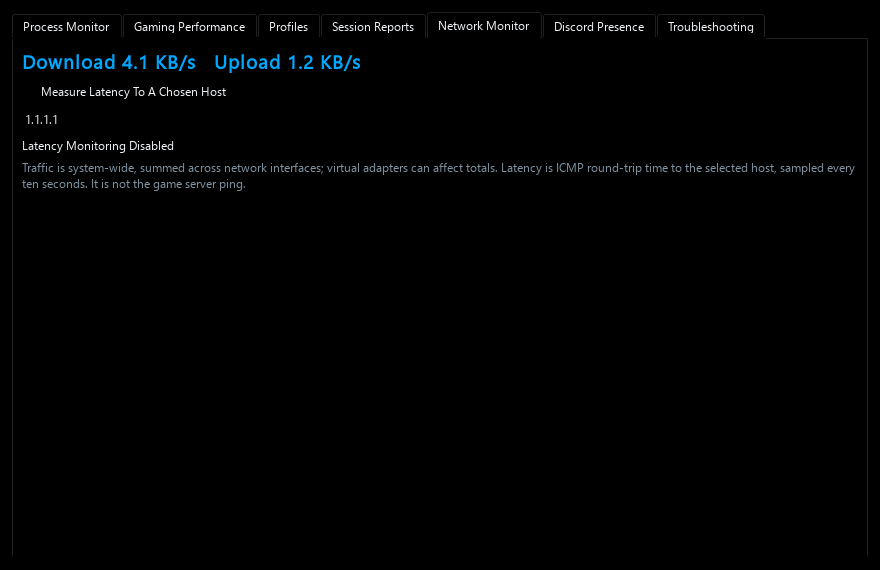

*Actual Interface Capture. Displayed Values Are A Recorded Snapshot Or Example.*

1. **Observe Rates:** Compare current download/upload activity with the workload.
2. **Choose A Host:** Use a relevant target for the optional ping.
3. **Interpret Failures:** Unavailable ping can mean ICMP is blocked.

**Separate Measurements:** FPS and network traffic answer different questions. Use both without implying a causal diagnosis.

## A Timeline For Troubleshooting

Event Monitor connects a visible symptom to recorded application observations.

Open Suite from the Event Monitor card. Search the timeline and filter by severity or subsystem. Records persist locally and show the latest 2,000 events. Export the relevant CSV/JSON subset. The performance-history view covers the current session up to ten minutes, with missing values remaining unavailable.

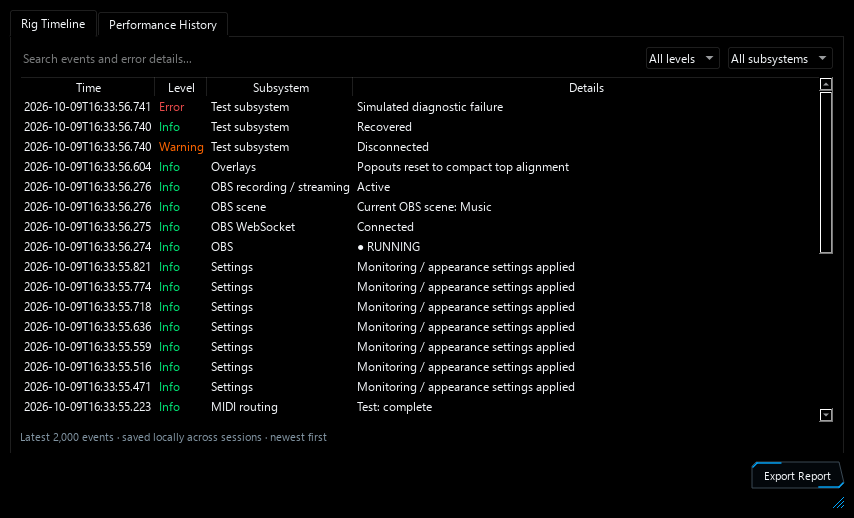

*Actual Interface Capture. Displayed Values Are A Recorded Snapshot Or Example.*

1. **Locate The Time:** Identify the time around the symptom or reconnect.
2. **Filter The Context:** Select the subsystem/severity that matters.
3. **Export Evidence:** Share a minimal, redacted excerpt with exact steps.

**Evidence Before Conclusions:** A recorded event is an observation. It is not a definitive diagnosis of every physical rig fault.

## Resource Use At The Application Level

Process Monitor helps identify the application and resource pattern associated with an issue.

Filter and sort CPU, RAM or disk activity. Review PID, uptime and thread count, and adjust watched apps. CPU is normalized by logical processor count. Disk throughput reflects changes in process read/write counters. The Windows Idle process is excluded; inaccessible fields can remain unavailable.

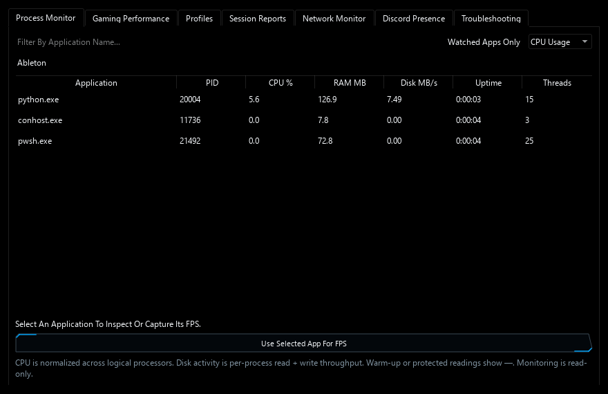

*Actual Interface Capture. Displayed Values Are A Recorded Snapshot Or Example.*

1. **Find The Process:** Filter the name and confirm its PID.
2. **Compare Readings:** Use multiple samples rather than one instant.
3. **Follow The Context:** Use events and the active workload to investigate further.

**Measured Values, Not A Benchmark Claim:** Process memory and disk counters have specific semantics. Avoid treating them as complete system diagnostics.

## A Reproducible Test Record

Session reports collect resource samples, rig events and FPS when available into a local JSON record.

Name a session, Start Session, reproduce the behavior, then Stop & Save. Select the report and Export Selected Report. The reviewed retention keeps up to 7,200 one-second samples and the latest 2,000 events. Reports are saved on Stop & Save or normal exit; crashes can prevent a final save.

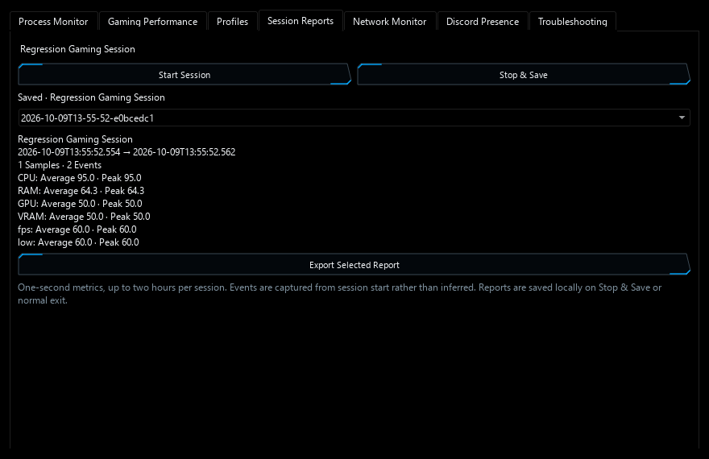

*Actual Interface Capture. Displayed Values Are A Recorded Snapshot Or Example.*

1. **Name The Test:** Include the task/device so the result is recognizable.
2. **Run The Scenario:** Keep steps and environment consistent.
3. **Save And Review:** Export only after checking for private details.

**Keep Reports Useful:** Record app/driver versions and exact steps separately. A report does not certify broad compatibility.

## Saved Layouts For Different Workflows

Technology Suite profiles preserve appearance, watched apps, card order and open overlay positions.

Arrange the workspace, enter a custom name and Save Current Layout. Select it later and Apply Profile. Built-in Studio, Gaming and Streaming profiles choose different overlays. Profiles are distinct from the dashboard Studio/Gamer mode buttons and do not rewrite routing, startup or Discord-sharing settings.

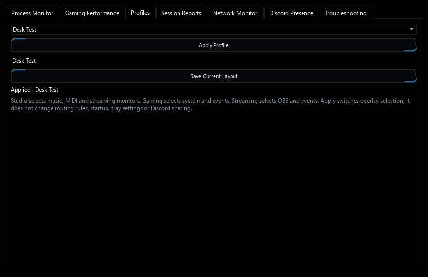

*Actual Interface Capture. Displayed Values Are A Recorded Snapshot Or Example.*

1. **Arrange:** Open and position the views you want to preserve.
2. **Save:** Choose a new custom name rather than a built-in name.
3. **Recall:** Apply the profile and review the resulting visibility.

**Separation Of Concerns:** Layout changes should not be mistaken for a new routing configuration.

## Readable Controls And Predictable Behavior

Settings separates dashboard visibility, overlay appearance, external connections and monitoring behavior.

Appearance controls dashboard/overlay text, size and opacity. Dashboard checkboxes hide cards. Devices configures control-app links. OBS connection configures the server. Monitoring / startup controls tray behavior, startup and utilization alerts. System Overlay chooses visible metrics. Review each tab deliberately rather than treating Apply as a universal reset.

*Actual Interface Capture. Displayed Values Are A Recorded Snapshot Or Example.*

1. **Readability:** Increase text before shrinking the workspace.
2. **Visibility:** Distinguish hiding a card from collapsing it.
3. **Persistence:** Restart and verify the choices that should be saved.

**External Applications Stay External:** Hardware links open configured tools on click. Ginja does not replace their setup or licenses.

## Choose The Metrics That Matter

A focused overlay can show only the readings useful for the current task.

Select CPU, RAM, GPU, VRAM and FPS independently. Toggle utilization dials as desired and apply. Unsupported temperature/sensor readings are hidden or unavailable; visible temperatures use Fahrenheit in the reviewed implementation. A selected FPS field still requires a functioning FPS provider.

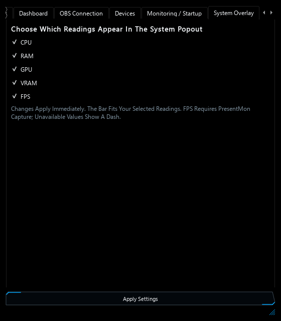

*Actual Interface Capture. Displayed Values Are A Recorded Snapshot Or Example.*

1. **Select:** Choose the actual metrics for this workload.
2. **Apply:** Confirm the compact view changes as expected.
3. **Validate:** Check that each displayed metric has a provider.

**Selected Does Not Mean Available:** Metric visibility is a display preference. It cannot create sensor or game-frame data.

## From A Symptom To A Useful Report

Use a repeatable sequence: confirm the symptom, inspect the relevant status, then collect the smallest useful evidence.

Missing artwork usually calls for a complete re-extraction. MIDI issues call for cable, driver and port-sharing checks. OBS needs matching WebSocket settings and a password each run. FPS needs the selected process and console provider. Audio enumeration needs the packaged helper. Check the Event Monitor before changing several settings at once.

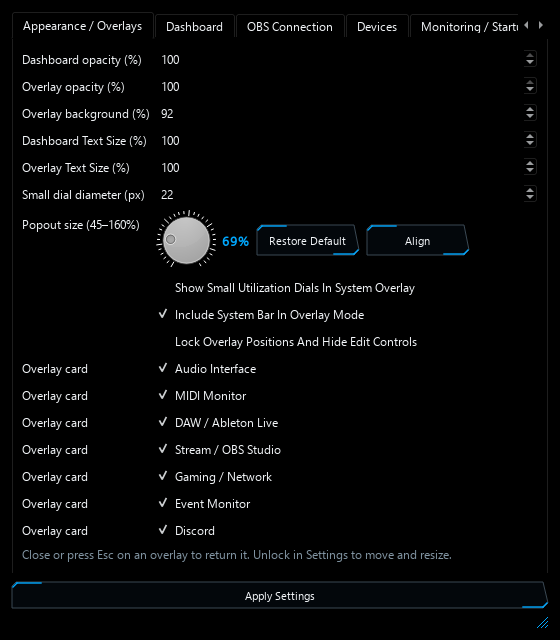

*Actual Interface Capture. Displayed Values Are A Recorded Snapshot Or Example.*

1. **Reproduce:** Describe exactly what you did and what changed.
2. **Inspect:** Compare the corresponding card and event timeline.
3. **Report:** Include build, Windows, driver and a redacted excerpt.

**Change One Variable At A Time:** This makes the result easier to understand and the fix easier to verify.

## Push 3 And Deeper Ableton Workflows

The roadmap extends the existing suite through more device- and application-specific workflows.

Push 3 expansions, deeper Ableton integration and routing/macro tooling are planned directions. They are not included simply because a device appears in the showcase. The existing CC-triggered sequence engine provides a concrete starting point for development.

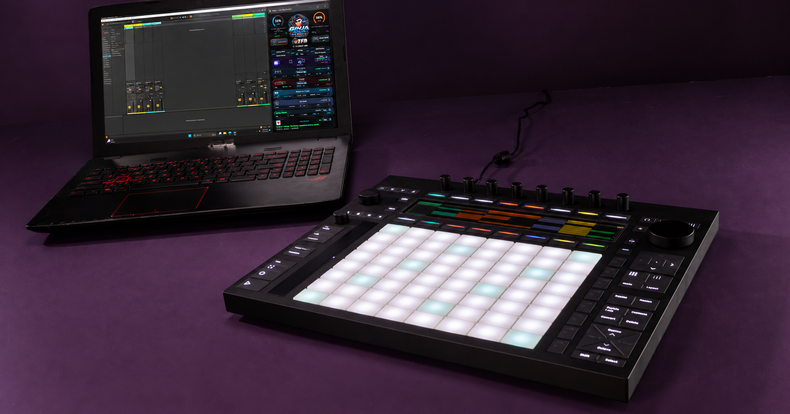

*Supplied Push Reference Photo With Ginja Composited Onto The Laptop. Planned Integration Illustration.*

1. **Current Foundation:** Monitoring, popouts and supported routing actions.
2. **Planned Work:** Device-specific workflows and further integration.
3. **Validation:** Document exact behavior when a capability is delivered.

**Upcoming:** No release date or broad device certification is promised.

## Synesthesia, Stream Deck And Controllers

Synesthesia is a music-synced visualization tool. Ginja integration is a future direction.

Possible Stream Deck actions and Xbox-controller workflows also belong to the roadmap. The current showcase uses recorded performance and illustrative connections to communicate the idea. It should not be interpreted as delivered support for those protocols or devices.

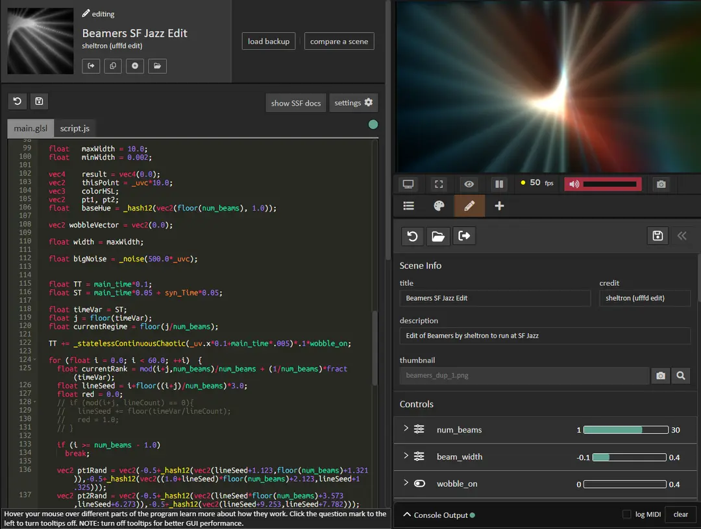

*User-Supplied Synesthesia Interface Reference. Ginja Integration Is Upcoming.*

1. **Synesthesia:** Potential coordination with music visualization.
2. **Stream Deck:** Possible actions connected to the rig workflow.
3. **Controller Inputs:** Possible gaming/controller workflows beyond current telemetry.

**Current And Upcoming Remain Separate:** Label the implemented behavior when an integration is actually added and tested.

# Practical Workflows

## A Repeatable First-Launch Test

Start with a small, known configuration. Establish a baseline before adding routing or extra integrations.

### Prepare The Environment

Record Windows, interface/controller drivers and the external application versions. Extract the entire private portable package into its own folder; do not pull the EXE out of its support directories. Connect one controller and launch one external application. This is a proposed acceptance exercise, not a completed second-PC test.

### Observe The Result

Check that the dashboard and artwork appear, the intended application is detected and the MIDI monitor responds to a known control. Open Event Monitor and review the launch period. Save a small session report after the successful baseline, with a separate note of the environment and actions performed.

### If The Result Differs

For missing artwork, restore the complete package. For missing MIDI activity, confirm device power, driver, cable and input-port access before changing a rule. For an application card, confirm the real process is running. Change one variable, repeat the baseline and keep the result as evidence.

## Build A Readable Multi-Monitor Workspace

Arrange feedback around your work, then check how it behaves when displays change.

### Configure Visibility

Choose Studio Mode or Gamer Mode for dashboard card selection. Use Settings > Dashboard to hide a card completely; the card X only collapses its contents. Open the popouts you actually need. These display choices are separate from whether a routing rule is enabled.

### Arrange And Preserve

Unlock overlay positions before moving or resizing them. Increase text size first, then refine panel size, opacity and background contrast. Use Align for a predictable arrangement. Save Current Layout under a new custom profile name after arranging the workspace; built-in profile names cannot be overwritten.

### Verify The Workspace

Close and reopen popouts, apply the saved profile and inspect their visibility and placement. Repeat after disconnecting a display. Recorded geometry is not a promise that a different monitor arrangement will be identical. Keep critical status readable and accessible rather than assuming every saved position remains ideal.

## Commission A Controller Before Routing

A rule should match evidence from the controller, rather than values assumed from a tutorial.

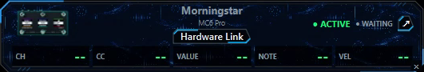

### Observe Press And Release

Press one physical control and record its input port, channel, CC number and value. Release it and check whether another value arrives. Notes and velocity can appear in the MIDI monitor, but the current rule engine triggers on control-change messages. Confirm the correct message type before building a rule.

### Choose A Specific Condition

Use the controller input and channel whenever possible. Set the observed CC and intended press value. Any Connected Input broadens the device match; Any Value broadens the value match. Continuous controls can produce many changes, so use these choices deliberately and review the repeat-suppression setting.

### Diagnose Missing Activity

If the monitor sees nothing, verify the device driver, USB connection and configured port. Check whether another application has exclusive port access. If the monitor sees messages but the rule does not run, compare all trigger fields and whether the rule is enabled. A resistor-ladder wiring issue remains a hardware configuration issue.

## A Worked MIDI Sequence

Adapt the example to a known destination and inspect each step before using it in a performance.

### Define The Example

Use an observed trigger such as channel 1, CC 20, value 127. Set the first action to PROGRAM 5 on your actual synth output. Add CC 7 with value 100 on the intended channel and a delay of 100 ms. Tutorial destination names are examples and must be replaced with real output-port names.

### Understand The Timing

Actions run from top to bottom. Delay applies before the associated action. WAIT adds an explicit pause. Program numbers use MIDI values 0–127 and may differ from a device display that numbers presets from 1. Confirm the device manual and the observed result instead of guessing the selected sound.

### Validate In Small Steps

Save the rule and use Test Sequence only after reviewing the outputs. It sends actions immediately. Confirm the first action alone, then add the next one. Finally test the real input control. Pair any NOTE ON with the intended NOTE OFF, using the same destination, pitch and channel.

## Prevent Repeats And Find Routing Failures

Separate trigger problems from destination or execution problems.

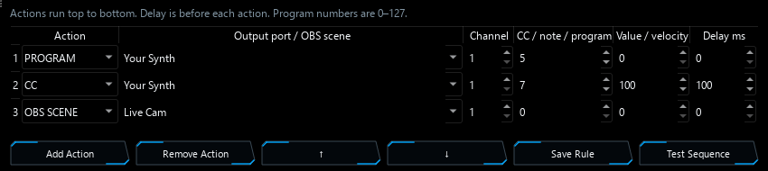

### Understand Repeat Behavior

Only Trigger When The Value Changes suppresses identical repeated trigger values. It does not impose a general time-based debounce on every changing message. The same rule is not queued again while it is already queued or running. Choose the value condition around the controller behavior you actually observed.

### Trace The Sequence

Use the MIDI monitor to confirm the input, then inspect routing/event evidence and the destination device. Test Sequence bypasses waiting for a trigger, which helps isolate a destination problem. It still performs real actions. A failed action stops the sequence; later actions may therefore never have run.

### Recover Deliberately

Correct the missing port, scene name or parameter before running again. If a note remains sounding after interruption, use the receiving instrument or host recovery controls; do not assume a stopped sequence always delivered its NOTE OFF. Recheck the rule and repeat a controlled test before relying on it live.

## Connect OBS And Verify The Real State

Use OBS as the stream source and Ginja as its connected status/control companion.

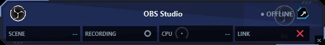

### Prepare OBS

In OBS, open Tools > WebSocket Server Settings and enable the server. Match its host, port and password in Settings > OBS connection. Defaults are localhost and 4455. The reviewed implementation saves host/port but keeps the password only during the current Ginja run, so re-enter it after restarting.

### Check State Against OBS

Compare the active scene and recording/streaming state in Ginja with OBS itself. Change the scene manually in OBS and confirm the corresponding observation. The composited performance image demonstrates placement, not an independently verified streaming connection. For live verification, inspect the actual running applications.

### Test Supported Control

Use the exact OBS scene name for an OBS SCENE action. Test recording start/stop only when prepared to create a real recording. Start/stop streaming is not a current routing action. If connection fails, compare credentials and endpoint, confirm OBS is running and inspect the relevant error before changing unrelated settings.

## Use Ableton Alongside Ginja

Connect the monitoring and MIDI workflow to the actual DAW session.

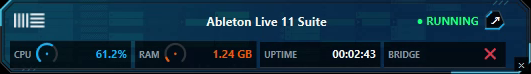

### Set Up The Session

Open Ableton and confirm the application card identifies the running process. Check MIDI and audio observations beside the DAW. Establish the controller-to-host path in Ableton and its preferences. Ginja process detection alone does not establish that a particular track, plug-in or MIDI mapping is ready.

### Verify A Mapping

Choose one known destination action and a small, deliberate MIDI mapping in Ableton. Confirm the output port and receiving configuration. Test the message and observe the intended change in Ableton itself. Do not assume a controller label or a successful MIDI send proves that the correct track received the command.

### Respect The Boundary

Current monitoring shows application/process context and MIDI activity; it is not complete track-state access, an audio mixer or control of every DAW function. Deeper Ableton integration and Push 3 extensions remain planned. Document exact behavior and validate it before updating the current-capabilities list.

## Identify And Troubleshoot An Audio Interface

Device metadata helps orient diagnosis; it does not replace a real signal-path test.

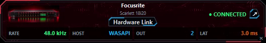

### Confirm Identity

Install the manufacturer driver on each PC. Compare the detected interface/host and available sample-rate/channel information with the interface panel and DAW. If a generic driver label is shown, check the configured model label under Devices. A hardware link opens the configured external control application.

### Check Sound Separately

Test playback or input in the DAW/interface tools. Inspect the selected audio device, channel assignment, sample rate and physical path there. Ginja does not mix audio or prove that every cable is healthy. Available latency information depends on the driver/query and should not be presented as a measured round-trip benchmark.

### Check The Packaged Runtime

Audio enumeration must work on the target PC without installed Python. The private build approach uses a separate discovery helper; include and test it with the complete package. If discovery fails, inspect the event evidence and build contents before interpreting missing metadata as a failed physical interface.

## Connect Discord Without Confusing Sharing

Profile connection, desktop process detection and public Rich Presence are separate concepts.

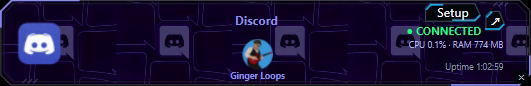

### Prepare The Connection

Keep desktop Discord running. Open Discord Presence tools or Setup, enter your own Application ID and review the profile-connection switch. An Application ID is not a user token or password. The optional RPC dependency must be available for the corresponding functionality.

### Choose Public Sharing

Review the separate Rich Presence choice before applying settings. Profile connection can return the name and public avatar; activity sharing publishes the selected activity. Saved settings and migrations can restore choices, so verify the visible switches rather than assuming every restart resets sharing to off.

### Verify And Limit Claims

Inspect the actual profile/connection result and review Discord visibility if sharing is enabled. A running process is not proof of account Online/Invisible state or voice connectivity. The reviewed profile connection does not expose notification feeds. Remove sensitive identifiers from any public troubleshooting evidence.

## Measure Gaming And Network Behavior

Start with valid providers and a repeatable workload.

### Configure FPS Capture

Install the official PresentMon console executable separately, browse to it, select the target running process and start capture. Borderless windowed mode is a useful starting point. Compare a steady scene with a more demanding scene while keeping other variables fixed; keep the selected process consistent.

### Read The Measurements

The reviewed provider uses displayed-frame timing, a five-second FPS window and the busiest recent swap chain. A 1% low requires at least 100 valid frames. Readings expire after three seconds without frames. Displayed FPS may include generated frames; missing capture data is not a measured zero FPS.

### Separate Network Questions

Network throughput is system-wide, not traffic attributed to the selected game. Optional ping describes the chosen host and may be blocked. Compare upload/download activity and the relevant service separately. Neither a good ping nor a high FPS reading certifies that an entire stream or network path is healthy.

## Capture An Incident With Event Monitor

Turn a vague symptom into a concise, reproducible record.

### Locate The Incident

Write down the action and approximate time. Open Suite from the Event Monitor card and inspect the corresponding timeline interval. Use search, subsystem and severity filters to narrow the context. Keep an adjacent successful period for comparison rather than exporting the entire history automatically.

### Interpret History

The persistent event view contains the latest 2,000 events. The performance-history view covers the current session up to ten minutes. Missing metrics stay unavailable. An event records an observation; it does not by itself establish the root cause of every physical cable, interface or external application fault.

### Export A Useful Excerpt

Export the relevant CSV/JSON subset. Include expected behavior, actual behavior, reproduction steps and versions in the report. Inspect the excerpt for usernames, paths, device identities and other unnecessary private details. Preserve enough context to reproduce the issue without publishing an unrestricted personal log.

## Create And Compare Session Reports

Use a named report to make repeated tests easier to compare.

### Record A Defined Scenario

Give the session a meaningful name, start recording, then perform a short, fixed sequence of actions. Keep Windows, driver/app versions, devices and workload written down separately. Repeat the same scenario after one deliberate change instead of mixing several changes into a single test.

### Save And Export

Use Stop & Save, select the resulting report and Export Selected Report. The reviewed retention keeps up to 7,200 one-second samples and the latest 2,000 events. Reports can save on normal exit, but a crash may prevent the final save. Confirm the expected report exists before relying on it as evidence.

### Compare With Context

Read resources, FPS when available and event timing together. Use Process Monitor to locate the application/PID and distinguish aggregate load from a specific process. Protected or warming-up fields may be unavailable. A report supports troubleshooting; it is not independent reliability certification or a customer benchmark.

## Preferences, Backup And A Second PC

Protect your working configuration before moving or changing the application.

### Know What Is Saved

The reviewed application uses Qt settings under the Ginja / LiveRigMonitor identity. Layout/profile settings are distinct from routing rules, startup/tray choices and Discord sharing. Custom profiles save appearance, watched apps, card order/groups and open overlay positions; they are not complete application backups.

### Plan A Transfer

Keep the original working installation intact. The current documentation does not provide a universal settings export/import button, so do not assume copying a profile or EXE transfers every choice. Record rule fields and configuration deliberately. Re-enter the OBS password, install drivers and validate ports/providers on the second PC.

### Test Recovery

Start with a separate private package and repeat the baseline test before a performance. Confirm artwork, audio discovery, MIDI, popouts and OBS. Do not promise a one-click reset or delete all settings as a first troubleshooting step. Preserve evidence and a backup before any future migration or reset procedure.

## A Pre-Performance And Post-Session Routine

Keep the final check focused on the actual workflow you will use.

### Before The Session

Confirm the intended devices, driver, MIDI ports, DAW session and OBS connection. Apply the known workspace and inspect critical fields. Test the specific routing sequences at a suitable moment. Verify sound in the audio host and check the actual stream/recording output through OBS; dashboard observations do not replace those checks.

### During The Session

Keep only useful popouts visible and readable. Watch for disconnects or unavailable values rather than treating every number as assurance. Avoid experimental rules or untested profile changes during a critical take. If something fails, note the time and minimize changes so the event history remains interpretable.

### After The Session

Stop and save the report if one is recording. Review incidents, export minimal redacted evidence and note the environment. Update known limitations when a reproducible issue is found. Keep upcoming integrations separate from the capabilities validated in this session. Turn observations into a targeted next development task.
